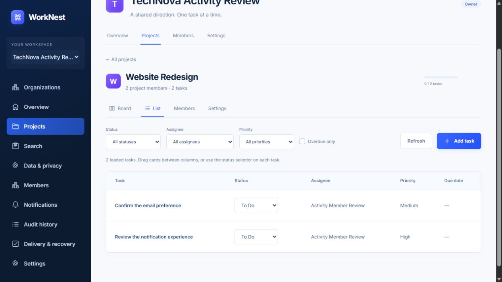

# Accessibility review

Reviewed locally on 17 October 2026 using keyboard interaction and the browser accessibility tree. This is a focused review, not a WCAG 2.2 AA certification or an NVDA/JAWS user study.

Changes made:

- Account and authenticated workspace screens now begin with a skip link that moves focus into main content. The link remains reachable on narrow screens.
- Project tabs use a single active tab stop, ArrowLeft/ArrowRight navigation, Home/End navigation, selected state and a labelled tab panel.
- Closing a native dialog explicitly restores focus to the control that opened it. Textarea focus styling is explicit.
- Reduced-motion preferences suppress interface animation/transitions.

Observed checks: Tab focused the login skip link; Enter moved focus to the main region. ArrowRight changed Board to List and moved focus to the List tab. Keyboard Enter opened the task dialog, Tab reached its labelled title field, and Escape closed it. After the focus fix, the opening Add task button received focus again. The list offers status controls as an alternative to dragging board cards. Labels and errors are exposed in the accessibility tree; existing role=alert notices announce failures.

Remaining pilot gate: a complete screen-reader pass with the intended assistive technology, systematic contrast/zoom/target-size audit, and coverage of all validation/error/loading flows. Do not claim full WCAG conformance from these checks alone.
