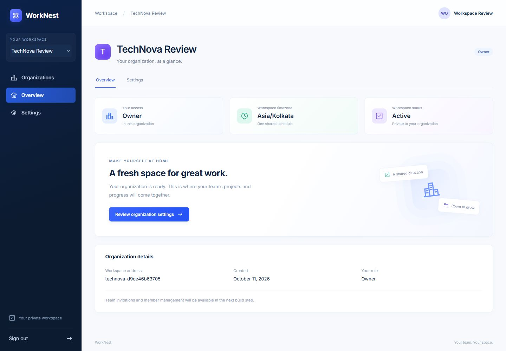
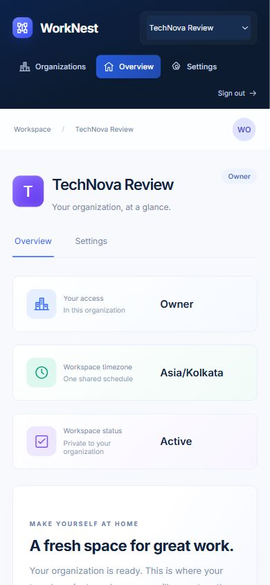

# Step 4 verification

Date: 11 October 2026. Scope: organizations and tenant isolation.

## Result

Verified accounts can create organizations, discover their memberships, switch workspaces, view an organization overview, and update settings as Owner/Admin. The UI follows the navy/blue reference and keeps real tenants separate from `/preview`. Creation, Owner membership, audit/outbox capture and retry response persistence commit together. Step 5 has not started.

## Checks performed

| Check | Observed result |
| --- | --- |
| Backend regression suite | **67 passed** against PostgreSQL and Redis, including 24 organization checks. |
| Restricted-role isolation | Organization API and adversarial queries run as a temporary non-owner, non-superuser, NOBYPASSRLS role. Wrong actor/organization context hides tenant content. |
| Real runtime role | `verify_tenant_security.py` passed inside the web container: all five tables have enabled and forced RLS; app is not their owner, cannot bypass RLS or truncate them; missing context returns zero rows. |
| Context cleanup | Missing context fails closed; sequential use of the same connection has no retained context; nested transaction rollback restores the outer context. |
| Atomic creation | Injected outbox failure rolls back organization, Owner membership, audit and retry record. Unique-slug conflicts return field errors. |
| Retry behavior | Same key/payload returns the original response; changed payload returns 409; expired key can be reused; two simultaneous requests create exactly one organization/event pair. Inaccessible organization cannot be disclosed by a saved replay. |
| Structural integrity | Raw SQL cannot commit an organization without its active Owner, remove that Owner without replacement, reference another organization's Owner, or link audit/outbox rows across organizations. |
| Permissions | Owner/Admin settings supported; Member/Viewer writes denied with 403; unrelated organization's Owner receives 404. Removed membership loses access on the next request while the global login remains valid. |
| Input and CSRF | Auth and verified email required where appropriate; CSRF enforced; forged organization/role fields rejected; invalid names, reserved/invalid slugs and timezones rejected; signed cursor and page-size validation tested. |
| Audit | Runtime audit edits/deletion denied; settings changes capture an event; unchanged settings do not add duplicate events. |
| Live HTTP flow | Real Vite proxy → Django app role → PostgreSQL, plus Celery verification email to Mailpit: creation, replay/conflict, settings, discovery, cross-tenant denial, CSRF and field rejection all passed. |
| Browser flow | Signed into a disposable verified review account, created Design Studio Review, saved a new name, switched to TechNova and back. Saved values remained; the unsaved draft was discarded. |
| Responsive UI | Reviewed at effective 1440×1000 desktop and approximately 390×844 mobile widths, correcting for the browser's display scaling. No horizontal page overflow. Saved desktop/mobile screenshots below. |
| Frontend | TypeScript checking and Vite production build passed after the final UI fixes. |
| Quality and schema | Ruff checks and formatting passed. Django system check passed. Migration consistency: no changes detected. |

Local services stopped during the interrupted session. Docker Desktop and the native frontend were restarted with existing volumes intact. The final backend image was rebuilt; schema and real runtime-role checks passed after restart. The frontend runs at `http://127.0.0.1:5174/`.

## Review evidence

Only disposable local review data appears in these images. Login credentials are kept outside Git.

## Boundaries

- This is a local development build. No public deployment or external email delivery was performed.
- CI now includes organization HTTP and runtime-role checks. Local passing results do not establish that GitHub-hosted CI passed.
- Outbox capture is durable and transactional. Invitation delivery belongs to Step 5; general dispatch/recovery and user-facing audit/notifications belong to Step 8.
- Team invitations, roster changes, ownership transfer and member limits await Step 5 approval. Project/task workflows remain later stages.
- RLS trusts server-installed actor context; its protection is not a claim of containment after arbitrary SQL execution or compromised database credentials. See `ORGANIZATIONS.md`.

Next checkpoint: ask the user before Step 5, after committing and pushing this completed step.
