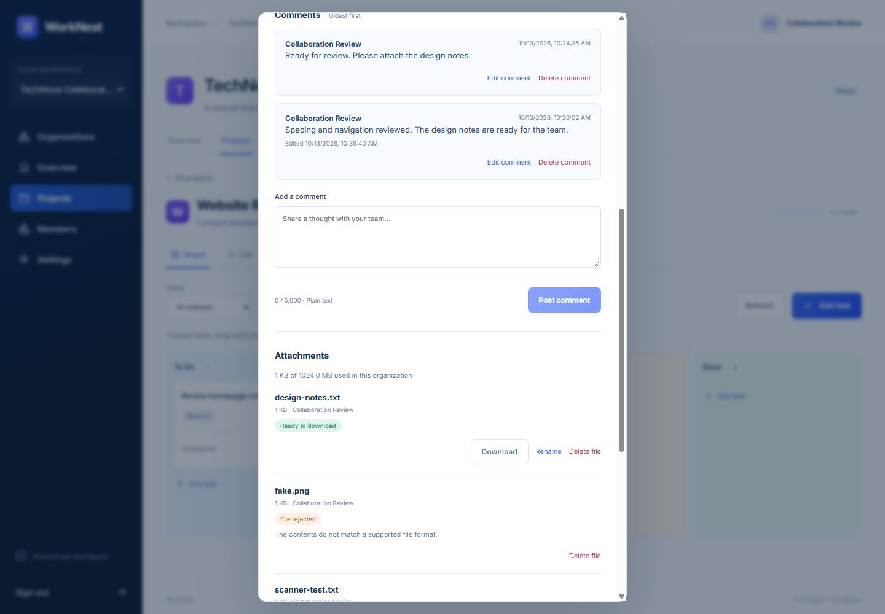

# Step 7 verification — 13 October 2026

## Delivered

Task comments and private attachments are connected to the existing task editor. The backend adds versioned comments, upload idempotency, private S3 quarantine, real ClamAV scanning, format validation, authenticated downloads, storage reservations, bounded cleanup retries and an explicit operator recovery command. The UI preserves the navy/blue WorkNest design and shows pending, ready and rejected files.

## Results

| Check | Observed result |
| --- | --- |
| Complete PostgreSQL/Redis backend regression suite | **155 passed** in 147.10 seconds |
| Collaboration-specific suite | **30 passed**, including role/project access, author-only edits, plain text, pagination, stale versions, replay, multipart limits, quota race, scan failure, cleanup retry and deletion during scan |
| Real S3 + Celery + ClamAV integration | Passed on API port 8000 and through the frontend proxy on 5174; clean TXT bytes/headers match, anonymous download denied, fake PNG and harmless EICAR antivirus signature rejected |
| Storage reservation cleanup | Rejected objects cleaned and usage returned to exactly the retained clean file size; repeated cleanup never releases twice |
| Runtime database user | Non-owner, non-superuser, NOBYPASSRLS; all **14** tenant tables force RLS, deny TRUNCATE and expose zero rows with missing context |
| Django and migrations | System check: no issues; migration drift: none |
| Python lint/format | Ruff checks passed; 71 files formatted |
| Frontend | TypeScript and production Vite build passed |
| Browser UI | Posted literal markup as plain text, edited a comment, uploaded a disposable TXT, observed quarantine then availability, downloaded a checked file |
| Responsive review | Desktop 1440×1000 and mobile 390×844 reviewed; mobile dialog content width equals scroll width (324px), no horizontal overflow; no browser error logs |

The final suite uses PostgreSQL with a restricted runtime-role fixture for authorization/RLS checks. Unit tests substitute storage/scanner dependencies for deterministic failures; the separate live smoke exercises actual private storage, ClamAV, workers, CSRF and API streaming. The EICAR test uses a harmless standard detection signature. No production users or external email recipients were used. Disposable credentials stay outside the repository.



## Reproduce

```powershell
# With the documented local test database environment:
cd backend
python -m pytest -q
python -m ruff check .
python -m ruff format --check .
cd ../frontend
npm run build
cd ..
docker compose up -d --build
docker compose run --rm storage-init
python backend/verify_collaboration.py --base-url http://localhost:5173
docker compose exec -T web python verify_tenant_security.py
docker compose run --rm migrate python manage.py makemigrations --check --dry-run
```

The CI integration job now starts the scanner and runs the live collaboration check. Local results above do not assert that a hosted GitHub Actions run passed. Initial ClamAV signatures require network access and startup time.

## Remaining stages

Step 8 covers notification inbox/email preferences, audit views, broader failed-job recovery and reconciliation (including orphan storage). Step 9 covers retention/purge and export/search. The pilot still needs provider configuration, scanner freshness monitoring and release-readiness verification. This step does not deploy the application publicly. See [collaboration operation and recovery](COLLABORATION.md).
