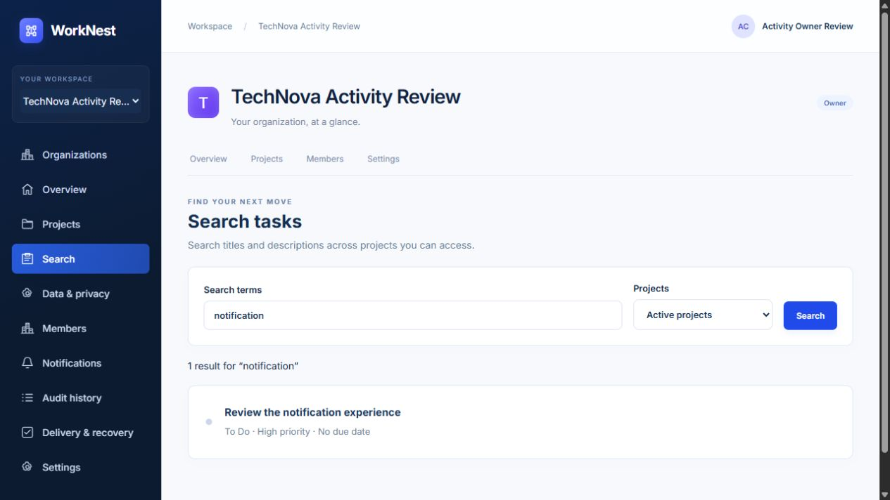
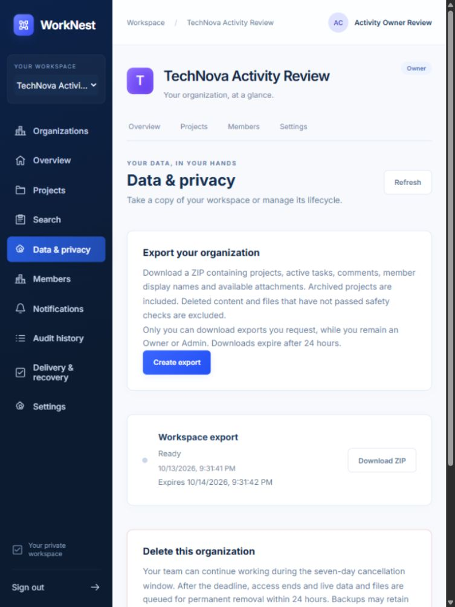

# Step 9 verification — 13 October 2026

Implemented scoped task search, asynchronous private ZIP exports, Owner password-confirmed organization deletion/cancellation, and retention/purge workers. See [lifecycle contract](LIFECYCLE.md).

## Automated checks

- Full PostgreSQL/Redis suite: 184 passed; two Redis-specific account tests initially failed because the native test process used the old host port 6379 instead of the local override 16379.
- Corrected the test environment and reran all account, team and lifecycle tests: **83 passed**, including both affected Redis tests and two newly added invitation/deletion-window cases. Across these runs all 188 current test cases passed; this is not a claim of a single 188-test run.
- Lifecycle coverage includes scoped search/counts/cursors, deleted/archived visibility, idempotent export jobs, permission revocation before/during generation and during download, expiry, safe ZIP contents, exact-job RLS, bounded failures, reauthentication, cancellation, deadline access closure, storage failure recovery, tenant purge and retention/quota cleanup.
- Live restricted-role database verification passed on **19 forced-RLS tenant tables**, including missing-context denial and denial of TRUNCATE.
- Django checks and migration drift checks passed. Ruff checks/format passed. Final TypeScript/Vite production build passed.

## Local integrated services

The live check exercised PostgreSQL, Redis, Celery/beat, private S3-compatible storage and ClamAV. A real uploaded text attachment passed scanning and appeared with matching contents inside an authenticated private ZIP. Replaying export creation returned the same job. Member export/deletion requests were rejected. Password-confirmed scheduling preserved ordinary access during the cancellation window; cancellation restored active status. Permanent purge tests ran against disposable test database organizations, not user workspace data.

The read-only maintenance operator command returned the expected queued state with no deletion deadline for the disposable review organization. Final backend containers were rebuilt with the invitation-window fix. Local host port overrides used Redis 16379 and Mailpit SMTP 11025 because the default ports were occupied; these overrides and disposable account credentials remain outside Git.

## Screen review

Authenticated desktop search returned the expected task with its project and status. Data & privacy showed a Ready export, download action, expiry and guarded deletion form. At a 390×844 mobile viewport, navigation and content reflowed without horizontal overflow. The viewport was reset after review.

## Limits and next stage

These are local results. Hosted GitHub Actions success, external email delivery, production hosting, backup infrastructure, performance targets and a production purge SLA are not claimed. Step 10 covers release readiness, accessibility, measured performance, backup/restore and API/demo documentation; it requires the user's next-stage approval.
